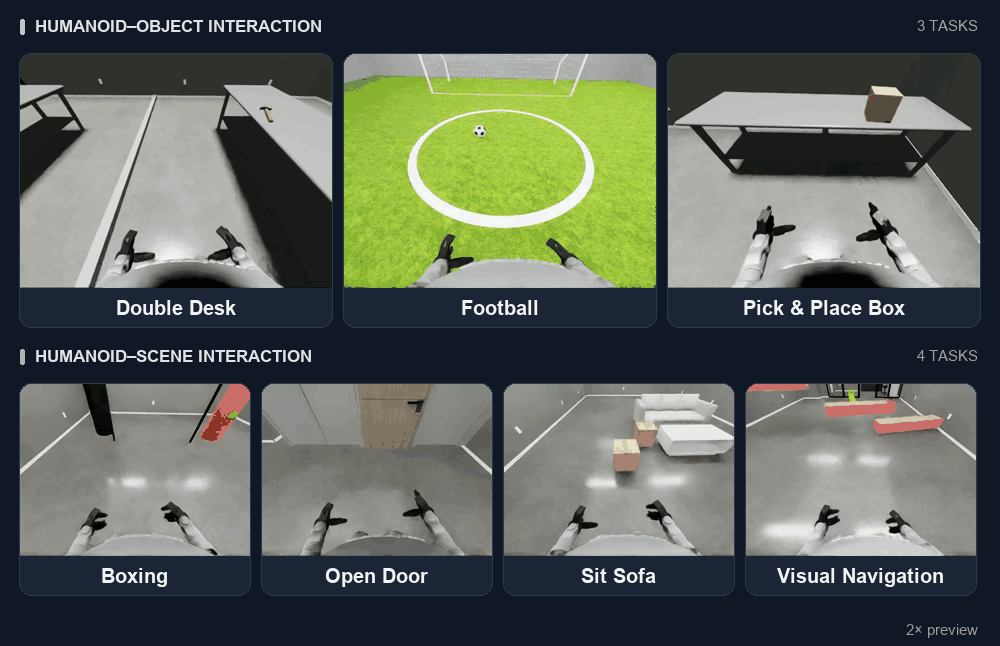
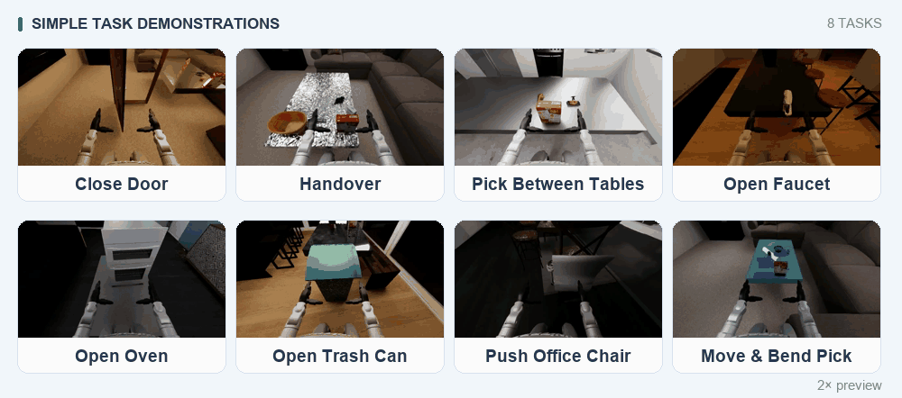
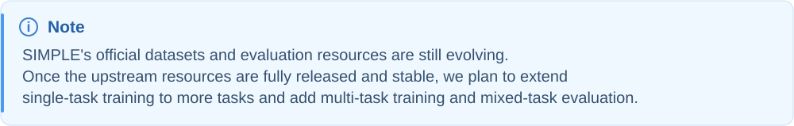

<p align="center">
  <picture>
    <source media="(prefers-color-scheme: dark)" srcset="asset/picture/kimodo-policy-title-dark.svg">
    
  </picture>
</p>

<p align="center">
  <strong>Yunheng Wang</strong><sup>1,*</sup> &nbsp;
  <strong>Jiaxi Zhang</strong><sup>1,*</sup> &nbsp;
  <strong>Wei Lu</strong><sup>1,*</sup> &nbsp;
  Yuetong Fang<sup>1</sup> &nbsp;
  Taowen Wang<sup>1</sup> &nbsp;
  Yixiao Feng<sup>1</sup><br>
  Shuning Zhang<sup>1</sup> &nbsp;
  Junzhe Xu<sup>1,2</sup> &nbsp;
  Yichi Wang<sup>3</sup> &nbsp;
  Zizhao Yuan<sup>1</sup> &nbsp;
  Kailun Huang<sup>1</sup><br>
  Lusong Li<sup>2</sup> &nbsp;
  Mingqian Zhou<sup>4</sup> &nbsp;
  Zecui Zeng<sup>2,†</sup> &nbsp;
  Renjing Xu<sup>1,†</sup>
</p>

<p align="center">
  <sup>1</sup>HKUST(GZ)&thinsp;·&thinsp;<sup>2</sup>JD Explore Academy&thinsp;·&thinsp;<sup>3</sup>BJUT&thinsp;·&thinsp;<sup>4</sup>Cambridge<br>
  <sub>* Equal contribution · † Co-corresponding authors</sub>
</p>

<p align="center">
  
  <a href="https://kimodo-policy.github.io/"></a>
  <a href="https://huggingface.co/datasets/YunhengWang/kimodo-policy"></a>
  <a href="https://huggingface.co/YunhengWang/kimodo-policy"></a>
  <a href="LICENSE"></a>
</p>

**Kimodo-Policy turns pretrained text-to-motion generators into humanoid vision-language-action policies.** Given egocentric vision, language instructions, and motion history, it predicts coordinated **root → body → hand** actions for closed-loop loco-manipulation. Our core idea is to reuse a frozen motion backbone’s learned coordination and temporal structure, while visual ControlNet branches and a dedicated HandNet ground these priors in the current scene. We evaluate this approach on HumanoidArena, SIMPLE, and real-world humanoid tasks.


## 🗺️ Open-Source Roadmap

- [x] [Kimodo-Policy Pretraining](#-kimodo-policy-pretraining)

- [x] [HumanoidArena Training & Evaluation](#-humanoidarena-training--evaluation)

- [x] [SIMPLE Training & Evaluation](#-simple-training--evaluation)

- [x] [Real-World Data Collection, Training & Deployment](#-real-world-data-collection-training--deployment)

- [ ] More Benchmarks (Coming Soon)

## ⚙️ Installation & Environment Setup

Use Ubuntu 22.04 or newer on x86_64, with Conda and a compatible NVIDIA GPU driver installed. SIMPLE also requires a CUDA 12.x toolkit with `nvcc` (12.8 recommended). The setup script installs all three environments and checks their imports:

| Environment | Python | Purpose |
| --- | --- | --- |
| `kimodo-policy` | 3.10 | Training and Arena policy serving |
| `unitree_sim_env` | 3.11 | HumanoidArena: Isaac Sim 5.0.0 + Isaac Lab 2.2.0 |
| `SIMPLE/.venv` | 3.10 | SIMPLE: MuJoCo 3.3.6 + Isaac Sim 4.5.0 |

### Quick Installation

Clone the project and run the setup script. The `--system-deps` option installs Ubuntu system packages and may request your sudo password. Use `--accept-isaac-eula` after reviewing and accepting the [Isaac Sim license](https://docs.omniverse.nvidia.com/isaacsim/latest/common/NVIDIA_Omniverse_License_Agreement.html).

```bash
GIT_LFS_SKIP_SMUDGE=1 git clone https://github.com/kimodo-policy/kimodo-policy.git
cd kimodo-policy
bash setup.sh --system-deps --accept-isaac-eula
source .setup/env.sh
```

If you already cloned the repository, run the last two commands from its root. The script installs Git LFS files, Python dependencies, Isaac Lab, and cuRobo. It uses the included Arena and SIMPLE integrations and keeps their simulator environments separate, following the [Arena](https://github.com/William-wAng618/HumanoidArena/blob/main/docs/04_environment_setup.md) and [SIMPLE](https://github.com/physical-superintelligence-lab/SIMPLE) setup workflows.

Existing named environments are reused; missing ones are created. Rerunning reinstalls the selected dependency versions and retries the setup without deleting environments. Logs are saved under `.setup/`; the runtime path file is published only after all selected installation and import checks pass.

### Optional Setup Commands

```bash
# Preview the installation plan without making changes.
bash setup.sh --dry-run

# Install only training dependencies.
bash setup.sh --only training

# Install one benchmark and the shared Kimodo model environment.
bash setup.sh --only arena --accept-isaac-eula
bash setup.sh --only simple --accept-isaac-eula

# Also download SONIC controller files and complete SIMPLE evaluation assets.
bash setup.sh --accept-isaac-eula --download-resources

# Check existing environments without reinstalling packages.
bash setup.sh --check --accept-isaac-eula
```

Use `--conda /path/to/bin/conda` if Conda is not detected. For SIMPLE, the script prefers `/usr/local/cuda-12.8` when available; set `CUDA_HOME` to select another CUDA 12.x toolkit. The script does not install GPU drivers or CUDA toolkits.

### Use the Installed Environments

In each new terminal, enter the repository and load its environment paths:

```bash
source .setup/env.sh
conda activate kimodo-policy
```

The generated file configures the Python executables, model dependency path, and default simulator/resource paths used by our wrappers. It does not activate a simulator environment; the evaluation wrappers select the correct runtime.

### Prepare Runtime Assets

Environment installation does not include model weights or benchmark datasets. Before evaluation, prepare:

- **Kimodo weights and text embeddings:** download the required [released checkpoints](https://huggingface.co/YunhengWang/kimodo-policy) and prepare the backbone/encoder files under `checkpoints/`. Task text embeddings are included in this Git repository under [`data/cache/`](data/cache/README.md), ready to use after cloning. Training generates embeddings for new instructions when the LLM2Vec weights are available.

- **Arena scenes and SONIC:** follow **Evaluation Assets** under **Data Preparation** below for the official downloads, our backup asset link, and the required directory layout.

- **SIMPLE:** follow **SIMPLE Training & Evaluation** below for model files, task text caches, training data and the complete evaluation resource bundle.

- **Training data:** follow **Data Preparation** below.

Add `--dry-run` to either evaluation wrapper to check its configuration and required paths before launching simulation. Installation/import checks do not replace a small end-to-end evaluation.

## 🤖 HumanoidArena Training & Evaluation

This section covers training and evaluation on HumanoidArena. Complete **Installation & Environment Setup** above first. Training and policy serving use `kimodo-policy`; the Arena simulator runs separately in `unitree_sim_env`.



### ⚙️ Runtime Paths

For training, activate the `kimodo-policy` environment and point the dataset variable to the local HumanoidArena dataset:

~~~bash
conda activate kimodo-policy
export KIMODO_ENV="$CONDA_PREFIX"
PROJECT_ROOT="$(git rev-parse --show-toplevel)"
export HUMANOID_ARENA_ROOT="$PROJECT_ROOT/data/HumanoidArena_dataset_v3_1"
test -d "$HUMANOID_ARENA_ROOT" || {
  echo "Missing HumanoidArena dataset: $HUMANOID_ARENA_ROOT" >&2
  exit 2
}
~~~

For evaluation, keep the simulator and model server in separate environments:

```bash
source .setup/env.sh
```

Before a full run, verify that the simulator Python, model-server Python, SONIC artifacts, text cache, and Isaac Lab task YAML are available. The evaluation wrappers provide dry-run validation without launching Isaac Sim.

### 📦 Data Preparation

#### • Training Data

Before training, download the dataset from the [official HumanoidArena website](https://humanoidarena.github.io/). If the official release is updated or changed, you can use our [archived dataset snapshot on Hugging Face](https://huggingface.co/datasets/YunhengWang/kimodo-policy/tree/main/data/HumanoidArena_dataset_v3_1) to reproduce the experiments with the same data version.

Activate the `kimodo-policy` environment with the project dependencies installed, then run the following commands from the repository root to download our archived snapshot:

```bash
conda activate kimodo-policy
PROJECT_ROOT="$(git rev-parse --show-toplevel)"
python -m pip install huggingface_hub
hf download YunhengWang/kimodo-policy \
  --repo-type dataset \
  --include "data/HumanoidArena_dataset_v3_1/**" \
  --local-dir "$PROJECT_ROOT"
export HUMANOID_ARENA_ROOT="$PROJECT_ROOT/data/HumanoidArena_dataset_v3_1"
```

If the dataset is gated or requires authentication, run hf auth login first.

Check dataset completeness and audit the first five selected episodes before training:

```bash
PROJECT_ROOT="$(git rev-parse --show-toplevel)"
export HUMANOID_ARENA_ROOT="${HUMANOID_ARENA_ROOT:-$PROJECT_ROOT/data/HumanoidArena_dataset_v3_1}"
python utils/check_datasets.py \
  --config scripts/HumanoidArena_Multi_Task/humanoidarena_sonicx7_gbs128_50w_controlnet4_detach_true_mse.yaml \
  --workers 1 \
  --limit 5 \
  --fail-on-errors \
  --output "$PROJECT_ROOT/log/humanoidarena_dataset_audit.json"
```

The checker verifies selected dataset files, episode metadata, state/action shapes, finite values, frame indices, timestamps, root rotations, and hand-command ranges. It also reports motion-continuity flags in the JSON report; these flags do not remove episodes or change training data. `--fail-on-errors` returns a nonzero exit status for data-reading or schema errors. Add `--fail-on-invalid` to also fail on motion-quality flags. Remove `--limit 5` to audit every selected episode. Video decoding is not checked.

#### • Evaluation Assets

Evaluation requires simulation assets and SONIC controller files in addition to the Kimodo checkpoint and task text cache. The training dataset alone is not sufficient.

**Simulation assets.** Download the [official HumanoidArena asset package](https://drive.google.com/file/d/1TCa_aVRmFrZs_l4wlxkqanNebvDtChNk/view) first, following the [official setup guide](https://github.com/William-wAng618/HumanoidArena/blob/main/docs/04_environment_setup.md). If the official download is unavailable or the assets change, use our [archived HumanoidArena assets on Hugging Face](https://huggingface.co/datasets/YunhengWang/kimodo-policy/tree/main/assets/humanoidarena_assets).

To download our backup, run from the repository root:

```bash
conda activate kimodo-policy
export PROJECT_ROOT="$(git rev-parse --show-toplevel)"
hf download YunhengWang/kimodo-policy \
  --repo-type dataset \
  --include "assets/humanoidarena_assets/**" \
  --local-dir "$PROJECT_ROOT/.setup/arena-assets"
```

The backup is downloaded under `.setup/arena-assets/assets/humanoidarena_assets/`. Extract any archives before placing the files in the simulator directory. For the official ZIP, replace the archive path below with your downloaded file:

```bash
export PROJECT_ROOT="$(git rev-parse --show-toplevel)"
export ARENA_ASSET_DIR="$PROJECT_ROOT/HumanoidArena/isaaclab_twist2_g1/assets"
mkdir -p "$ARENA_ASSET_DIR"
unzip /path/to/humanoidarena_assets.zip -d "$ARENA_ASSET_DIR"
```

This extraction command assumes the archive contains `objects/` and `robots/` at its root. If it already contains an `assets/` directory, extract it into `HumanoidArena/isaaclab_twist2_g1/` instead. For an unpacked backup, copy its `objects/` and `robots/` directories into `$ARENA_ASSET_DIR/`. Both download sources must produce this layout, without an extra nested `assets/` folder:

```text
HumanoidArena/isaaclab_twist2_g1/assets/
├── objects/
└── robots/
```

**SONIC controller.** Download the three controller files from the [official NVIDIA GEAR-SONIC release](https://huggingface.co/nvidia/GEAR-SONIC). Skip this download if setup was already run with `--download-resources`.

```bash
conda activate kimodo-policy
export PROJECT_ROOT="$(git rev-parse --show-toplevel)"
export SONIC_POLICY_ROOT="$PROJECT_ROOT/HumanoidArena/GR00T-WholeBodyControl/gear_sonic_deploy/policy/release"
hf download nvidia/GEAR-SONIC \
  model_encoder.onnx model_decoder.onnx observation_config.yaml \
  --local-dir "$SONIC_POLICY_ROOT"
```

Check the installed resource paths before evaluation:

```bash
(
  set -eu
  PROJECT_ROOT="$(git rev-parse --show-toplevel)"
  ARENA_ASSET_DIR="$PROJECT_ROOT/HumanoidArena/isaaclab_twist2_g1/assets"
  SONIC_POLICY_ROOT="$PROJECT_ROOT/HumanoidArena/GR00T-WholeBodyControl/gear_sonic_deploy/policy/release"
  for directory in objects robots; do
    test -d "$ARENA_ASSET_DIR/$directory" || {
      echo "Missing simulation assets: $ARENA_ASSET_DIR/$directory" >&2
      exit 1
    }
  done
  for file in model_encoder.onnx model_decoder.onnx observation_config.yaml; do
    test -s "$SONIC_POLICY_ROOT/$file" || {
      echo "Missing SONIC file: $SONIC_POLICY_ROOT/$file" >&2
      exit 1
    }
  done
  echo "Arena asset directories and SONIC files found."
)
```

These are presence checks, not a full asset-integrity or rendering test. `check_datasets.py` audits training episodes; it does not validate simulator assets. Before a full evaluation, prepare the task checkpoint and use the bundled `data/cache/HumanoidArena/` embeddings, run the evaluation wrapper with `--dry-run`, and verify a small simulation run.

### 🚀 Kimodo-Policy Single-Task Training on HumanoidArena

To help you quickly reproduce our HumanoidArena results, we provide downloadable checkpoints corresponding to the paper, along with evaluation results and visualizations. For each task, the table below includes both a model fine-tuned from 419h pretraining and a model trained from scratch. Click a checkpoint to download the weights, or a result to explore the evaluations and visualizations.

| Task | Pretrain | Kimodo-Policy checkpoint | Results&nbsp;(SR) |
| --- | --- | --- | --- |
| doubledesk | ❌ | [humanoidarena_single_gbs64_20w_HOI_double_desk](https://huggingface.co/YunhengWang/kimodo-policy/tree/main/HumanoidArena_Single_Task/humanoidarena_single_gbs64_20w_controlnet4_detach_true_mse_HOI_double_desk_sonic) | [40.0 ± 0.0%](https://huggingface.co/datasets/YunhengWang/kimodo-policy/tree/main/eval_results/HumanoidArena_Single_Task/humanoidarena_single_gbs64_20w_controlnet4_detach_true_mse_HOI_double_desk_sonic) |
| football | ❌ | [humanoidarena_single_gbs64_20w_HOI_football](https://huggingface.co/YunhengWang/kimodo-policy/tree/main/HumanoidArena_Single_Task/humanoidarena_single_gbs64_20w_controlnet4_detach_true_mse_HOI_football_sonic) | [28.3 ± 6.2%](https://huggingface.co/datasets/YunhengWang/kimodo-policy/tree/main/eval_results/HumanoidArena_Single_Task/humanoidarena_single_gbs64_20w_controlnet4_detach_true_mse_HOI_football_sonic) |
| pp_box | ❌ | [humanoidarena_single_gbs64_20w_HOI_pp_box](https://huggingface.co/YunhengWang/kimodo-policy/tree/main/HumanoidArena_Single_Task/humanoidarena_single_gbs64_20w_controlnet4_detach_true_mse_HOI_pp_box_sonic) | [80.0 ± 4.1%](https://huggingface.co/datasets/YunhengWang/kimodo-policy/tree/main/eval_results/HumanoidArena_Single_Task/humanoidarena_single_gbs64_20w_controlnet4_detach_true_mse_HOI_pp_box_sonic) |
| boxing | ❌ | [humanoidarena_single_gbs64_20w_HSI_boxing](https://huggingface.co/YunhengWang/kimodo-policy/tree/main/HumanoidArena_Single_Task/humanoidarena_single_gbs64_20w_controlnet4_detach_true_mse_HSI_boxing_sonic) | [73.3 ± 13.1%](https://huggingface.co/datasets/YunhengWang/kimodo-policy/tree/main/eval_results/HumanoidArena_Single_Task/humanoidarena_single_gbs64_20w_controlnet4_detach_true_mse_HSI_boxing_sonic) |
| open_door | ❌ | [humanoidarena_single_gbs64_20w_HSI_open_door](https://huggingface.co/YunhengWang/kimodo-policy/tree/main/HumanoidArena_Single_Task/humanoidarena_single_gbs64_20w_controlnet4_detach_true_mse_HSI_open_door_sonic) | [90.0 ± 4.1%](https://huggingface.co/datasets/YunhengWang/kimodo-policy/tree/main/eval_results/HumanoidArena_Single_Task/humanoidarena_single_gbs64_20w_controlnet4_detach_true_mse_HSI_open_door_sonic) |
| sit_sofa | ❌ | [humanoidarena_single_gbs64_20w_HSI_sit_sofa](https://huggingface.co/YunhengWang/kimodo-policy/tree/main/HumanoidArena_Single_Task/humanoidarena_single_gbs64_20w_controlnet4_detach_true_mse_HSI_sit_sofa_sonic) | [100.0 ± 0.0%](https://huggingface.co/datasets/YunhengWang/kimodo-policy/tree/main/eval_results/HumanoidArena_Single_Task/humanoidarena_single_gbs64_20w_controlnet4_detach_true_mse_HSI_sit_sofa_sonic) |
| vision_navi | ❌ | [humanoidarena_single_gbs64_20w_HSI_vision_navi](https://huggingface.co/YunhengWang/kimodo-policy/tree/main/HumanoidArena_Single_Task/humanoidarena_single_gbs64_20w_controlnet4_detach_true_mse_HSI_vision_navi_sonic) | [75.0 ± 10.8%](https://huggingface.co/datasets/YunhengWang/kimodo-policy/tree/main/eval_results/HumanoidArena_Single_Task/humanoidarena_single_gbs64_20w_controlnet4_detach_true_mse_HSI_vision_navi_sonic) |
| doubledesk | ✅ | [ft_419h_humanoidarena_single_gbs64_20w_HOI_double_desk](https://huggingface.co/YunhengWang/kimodo-policy/tree/main/HumanoidArena_Single_Task/ft_419h_humanoidarena_single_gbs64_20w_controlnet4_detach_true_mse_HOI_double_desk_sonic) | [28.3 ± 2.4%](https://huggingface.co/datasets/YunhengWang/kimodo-policy/tree/main/eval_results/HumanoidArena_Single_Task/ft_419h_humanoidarena_single_gbs64_20w_controlnet4_detach_true_mse_HOI_double_desk_sonic) |
| football | ✅ | [ft_419h_humanoidarena_single_gbs64_20w_HOI_football](https://huggingface.co/YunhengWang/kimodo-policy/tree/main/HumanoidArena_Single_Task/ft_419h_humanoidarena_single_gbs64_20w_controlnet4_detach_true_mse_HOI_football_sonic) | [26.7 ± 4.7%](https://huggingface.co/datasets/YunhengWang/kimodo-policy/tree/main/eval_results/HumanoidArena_Single_Task/ft_419h_humanoidarena_single_gbs64_20w_controlnet4_detach_true_mse_HOI_football_sonic) |
| pp_box | ✅ | [ft_419h_humanoidarena_single_gbs64_20w_HOI_pp_box](https://huggingface.co/YunhengWang/kimodo-policy/tree/main/HumanoidArena_Single_Task/ft_419h_humanoidarena_single_gbs64_20w_controlnet4_detach_true_mse_HOI_pp_box_sonic) | [78.3 ± 8.5%](https://huggingface.co/datasets/YunhengWang/kimodo-policy/tree/main/eval_results/HumanoidArena_Single_Task/ft_419h_humanoidarena_single_gbs64_20w_controlnet4_detach_true_mse_HOI_pp_box_sonic) |
| boxing | ✅ | [ft_419h_humanoidarena_single_gbs64_20w_HSI_boxing](https://huggingface.co/YunhengWang/kimodo-policy/tree/main/HumanoidArena_Single_Task/ft_419h_humanoidarena_single_gbs64_20w_controlnet4_detach_true_mse_HSI_boxing_sonic) | [70.0 ± 8.2%](https://huggingface.co/datasets/YunhengWang/kimodo-policy/tree/main/eval_results/HumanoidArena_Single_Task/ft_419h_humanoidarena_single_gbs64_20w_controlnet4_detach_true_mse_HSI_boxing_sonic) |
| open_door | ✅ | [ft_419h_humanoidarena_single_gbs64_20w_HSI_open_door](https://huggingface.co/YunhengWang/kimodo-policy/tree/main/HumanoidArena_Single_Task/ft_419h_humanoidarena_single_gbs64_20w_controlnet4_detach_true_mse_HSI_open_door_sonic) | [93.3 ± 2.4%](https://huggingface.co/datasets/YunhengWang/kimodo-policy/tree/main/eval_results/HumanoidArena_Single_Task/ft_419h_humanoidarena_single_gbs64_20w_controlnet4_detach_true_mse_HSI_open_door_sonic) |
| sit_sofa | ✅ | [ft_419h_humanoidarena_single_gbs64_20w_HSI_sit_sofa](https://huggingface.co/YunhengWang/kimodo-policy/tree/main/HumanoidArena_Single_Task/ft_419h_humanoidarena_single_gbs64_20w_controlnet4_detach_true_mse_HSI_sit_sofa_sonic) | [96.7 ± 2.4%](https://huggingface.co/datasets/YunhengWang/kimodo-policy/tree/main/eval_results/HumanoidArena_Single_Task/ft_419h_humanoidarena_single_gbs64_20w_controlnet4_detach_true_mse_HSI_sit_sofa_sonic) |
| vision_navi | ✅ | [ft_419h_humanoidarena_single_gbs64_20w_HSI_vision_navi](https://huggingface.co/YunhengWang/kimodo-policy/tree/main/HumanoidArena_Single_Task/ft_419h_humanoidarena_single_gbs64_20w_controlnet4_detach_true_mse_HSI_vision_navi_sonic) | [76.7 ± 18.9%](https://huggingface.co/datasets/YunhengWang/kimodo-policy/tree/main/eval_results/HumanoidArena_Single_Task/ft_419h_humanoidarena_single_gbs64_20w_controlnet4_detach_true_mse_HSI_vision_navi_sonic) |

You can also train each task from scratch or fine-tune from a pretrained checkpoint available in our [Hugging Face model repository](https://huggingface.co/YunhengWang/kimodo-policy/tree/main). The default configuration uses **4 GPUs** (`KIMODO_GPUS=0,1,2,3`). Run the following commands from the repository root, replacing the dataset and checkpoint paths with your local paths and `doubledesk` with your target task.

**Train from scratch:**

```bash
conda activate kimodo-policy
export KIMODO_ENV="$CONDA_PREFIX"
KIMODO_GPUS=0,1,2,3 \
HUMANOID_ARENA_ROOT=/path/to/HumanoidArena_dataset_v3_1 \
bash scripts/HumanoidArena_Single_Task/humanoidarena_single_gbs64_20w_controlnet4_detach_true_mse.sh \
  doubledesk sonic
```

**Fine-tune from a pretrained checkpoint:**

```bash
conda activate kimodo-policy
export KIMODO_ENV="$CONDA_PREFIX"
KIMODO_GPUS=0,1,2,3 \
HUMANOID_ARENA_ROOT=/path/to/HumanoidArena_dataset_v3_1 \
bash scripts/HumanoidArena_Single_Task/ft_humanoidarena_single_gbs64_20w_controlnet4_detach_true_mse.sh \
  doubledesk sonic /path/to/pretrain/checkpoint_STEP
```

### 🚀 Kimodo-Policy Multi-Task Training on HumanoidArena

To help you reproduce our multi-task HumanoidArena experiments, we provide downloadable checkpoints, evaluation results, and visualizations for policies jointly trained on all seven tasks. The table lists the following variants in order:

- **Standard:** Kimodo-G1-RP-v1 motion backbone with the default policy architecture, trained without VLA policy pretraining.

- **SEED:** The same policy architecture with the Kimodo-G1-SEED-v1 motion backbone, isolating the effect of the motion prior.

- **Large:** The RP-v1 backbone with increased ControlNet capacity, raising active policy parameters from 91.7M to 158.9M, without VLA policy pretraining.

- **105h:** The standard model fine-tuned from 105 hours of VLA policy pretraining.

- **419h:** The standard model fine-tuned from 419 hours of VLA policy pretraining, achieving the best overall success rate among these variants.

`Pretrain` refers to VLA policy pretraining; all variants retain a pretrained, frozen motion backbone. HOI and HSI report mean success rates for human–object and human–scene interaction tasks, respectively. Click a checkpoint to download the weights, or an overall result to explore the evaluations and visualizations.

| Task | Pretrain | Kimodo-Policy checkpoint | HOI Avg. | HSI Avg. | Overall Results |
| --- | --- | --- | --- | --- | --- |
| multi-task | ❌ | [humanoidarena_sonicx7_gbs128_50w](https://huggingface.co/YunhengWang/kimodo-policy/tree/main/HumanoidArena_Multi_Task/humanoidarena_sonicx7_gbs128_50w_controlnet4_detach_true_mse) | 51.7% | 79.6% | [67.6%](https://huggingface.co/datasets/YunhengWang/kimodo-policy/tree/main/eval_results/HumanoidArena_Multi_Task/humanoidarena_sonicx7_gbs128_50w_controlnet4_detach_true_mse) |
| multi-task | ❌ | [humanoidarena_sonicx7_gbs128_50w_SEED](https://huggingface.co/YunhengWang/kimodo-policy/tree/main/HumanoidArena_Multi_Task/humanoidarena_sonicx7_gbs128_50w_controlnet4_detach_true_mse_SEED) | 52.8% | 72.9% | [64.3%](https://huggingface.co/datasets/YunhengWang/kimodo-policy/tree/main/eval_results/HumanoidArena_Multi_Task/humanoidarena_sonicx7_gbs128_50w_controlnet4_detach_true_mse_SEED) |
| multi-task | ❌ | [humanoidarena_sonicx7_gbs128_50w_large](https://huggingface.co/YunhengWang/kimodo-policy/tree/main/HumanoidArena_Multi_Task/humanoidarena_sonicx7_gbs128_50w_controlnet4_detach_true_mse_large) | 45.6% | 85.8% | [68.6%](https://huggingface.co/datasets/YunhengWang/kimodo-policy/tree/main/eval_results/HumanoidArena_Multi_Task/humanoidarena_sonicx7_gbs128_50w_controlnet4_detach_true_mse_large) |
| multi-task | ✅ 105h | [ft_105h_humanoidarena_sonicx7_gbs128_50w](https://huggingface.co/YunhengWang/kimodo-policy/tree/main/HumanoidArena_Multi_Task/ft_105h_humanoidarena_sonicx7_gbs128_50w_controlnet4_detach_true_mse) | 48.9% | 82.5% | [68.1%](https://huggingface.co/datasets/YunhengWang/kimodo-policy/tree/main/eval_results/HumanoidArena_Multi_Task/ft_105h_humanoidarena_sonicx7_gbs128_50w_controlnet4_detach_true_mse) |
| multi-task | ✅ 419h | [ft_419h_humanoidarena_sonicx7_gbs128_50w](https://huggingface.co/YunhengWang/kimodo-policy/tree/main/HumanoidArena_Multi_Task/ft_419h_humanoidarena_sonicx7_gbs128_50w_controlnet4_detach_true_mse) | 56.1% | 84.2% | [72.1%](https://huggingface.co/datasets/YunhengWang/kimodo-policy/tree/main/eval_results/HumanoidArena_Multi_Task/ft_419h_humanoidarena_sonicx7_gbs128_50w_controlnet4_detach_true_mse) |

You can also train a single policy jointly on all seven HumanoidArena tasks from scratch or fine-tune from a pretrained checkpoint available in our [Hugging Face model repository](https://huggingface.co/YunhengWang/kimodo-policy/tree/main). The default configuration uses **4 GPUs** (`KIMODO_GPUS=0,1,2,3`). Run the following commands from the repository root, replacing the dataset and checkpoint paths with your local paths.

**Train from scratch:**

```bash
conda activate kimodo-policy
export KIMODO_ENV="$CONDA_PREFIX"
KIMODO_GPUS=0,1,2,3 \
HUMANOID_ARENA_ROOT=/path/to/HumanoidArena_dataset_v3_1 \
bash scripts/HumanoidArena_Multi_Task/humanoidarena_sonicx7_gbs128_50w_controlnet4_detach_true_mse.sh
```

**Fine-tune from a pretrained checkpoint:**

```bash
conda activate kimodo-policy
export KIMODO_ENV="$CONDA_PREFIX"
KIMODO_GPUS=0,1,2,3 \
HUMANOID_ARENA_ROOT=/path/to/HumanoidArena_dataset_v3_1 \
bash scripts/HumanoidArena_Multi_Task/ft_humanoidarena_sonicx7_gbs128_50w_controlnet4_detach_true_mse.sh \
  /path/to/pretrain/checkpoint_STEP
```

### 🧪 Evaluation

We evaluate Kimodo-Policy on HumanoidArena with SONIC. The default evaluation setup uses **3 GPUs** (`--gpus 0,1,2`). The Isaac Sim/Isaac Lab simulator runs in `unitree_sim_env`, while the Kimodo inference server runs in `kimodo-policy`. Install both environments as described in **Installation & Environment Setup**, then configure **Runtime Paths** above.

#### • SONIC evaluation

Run the command below from the repository root to evaluate `doubledesk`. Replace the task name and checkpoint path with your own, and adjust `--gpus` if you use different GPU IDs. The example uses seeds `0,1,2`, disables RTC and persistent simulator reuse, and enables deterministic simulator startup.

```bash
PROJECT_ROOT="$(git rev-parse --show-toplevel)"
bash evaluation/humanoidarena_eval_signal_task_sonic.sh \
  --project "$PROJECT_ROOT" \
  --task doubledesk \
  --checkpoint /path/to/checkpoint_STEP \
  --gpus 0,1,2 \
  --seeds 0,1,2 \
  --repeats 20 \
  --dtype fp32 \
  --diffusion-steps 10 \
  --execution-frames 15 \
  --rtc 0 \
  --persistent-sim 0 \
  --deterministic-eval 1 \
  --results-dir "$PROJECT_ROOT/eval_results/arena_doubledesk"
```

To evaluate multiple tasks, use `evaluation/humanoidarena_eval_multi_task_sonic.sh`. See [HumanoidArena Evaluation](evaluation/humanoidarena_eval.md) for task selection, video recording, and result aggregation.

Use a separate `--results-dir` for each evaluation run. Summary statistics, per-episode results, and optional videos are saved there. The checkpoint must be a Kimodo-Policy training checkpoint; SONIC simulator assets are configured separately.


## 🤖 SIMPLE Training & Evaluation

Train Kimodo-Policy directly on SIMPLE demonstrations or evaluate our released policies. Training uses `kimodo-policy`; evaluation uses `SIMPLE/.venv`. Complete the environment setup above, then follow the [step-by-step SIMPLE guide](evaluation/simple_eval.md) for downloads and commands.



### 📦 Data Preparation

#### • Training Data

Download demonstrations from the [official SIMPLE training dataset](https://huggingface.co/datasets/USC-PSI-Lab/psi-data/tree/main/simple). If the official data changes or a task is unavailable, use our [frozen training snapshots](https://huggingface.co/datasets/YunhengWang/kimodo-policy/tree/main/data/Simple). The snapshots contain only the eight evaluated tasks and 794 demonstrations, including `G1WholebodyXMoveBendPickTeleop-v0`. The loader reads the original LeRobot format without replay or conversion.

```bash
# Download one frozen training task; task text embeddings are bundled in Git.
export TASK=G1WholebodyCloseDoorTeleop-v0
python utils/prepare_simple.py --training-task "$TASK"
export KIMODO_SIMPLE_ROOT="$PWD/datasets/Simple"

KIMODO_SIMPLE_TASK="$TASK" python utils/check_datasets.py \
  --config scripts/Simple_Single_Task/ft_simple_single_gbs64_20w_controlnet4_detach_true_mse_continuous_hand.yaml \
  --workers 4 --fail-on-errors --output simple_data_check.json
```

The check validates metadata, parquet contents and video presence; it does not decode every video frame. Instructions for downloading the official archives are in the [training guide](evaluation/simple_eval.md#4-training-data-and-commands).

#### • Evaluation Assets & Model Dependencies

Official resources are available from [SIMPLE assets](https://huggingface.co/datasets/USC-PSI-Lab/SIMPLE) and [evaluation episodes](https://huggingface.co/datasets/USC-PSI-Lab/psi-data/tree/main/simple-eval). Our [frozen backup](https://huggingface.co/datasets/YunhengWang/kimodo-policy/tree/main/assets/simple_assets) includes robots, grasp objects, articulated objects, containers, six rooms, materials and fixed evaluation episodes. The small task text embeddings are included in this Git repository.

```bash
python utils/prepare_simple.py --assets
hf download YunhengWang/kimodo-policy \
  --include 'checkpoints/Kimodo-G1-RP-v1/**' \
            'checkpoints/dinov3-vitl16-pretrain-lvd1689m/**' \
  --local-dir .
```

The helper verifies checksums and installs resources under `SIMPLE/data/`. The frozen episodes cover 12 tasks × 3 levels × 10 episodes; the bundled [`data/cache/Simple/`](data/cache/Simple) embeddings cover the eight evaluated tasks and require no separate download. For these instructions, the full Llama/LLM2Vec weights are unnecessary. Environment directories and CUDA binaries are installed or compiled locally.

### 🚀 Kimodo-Policy Single-Task Training on SIMPLE

To help you quickly reproduce our SIMPLE results, we provide eight task-specific checkpoints, each fine-tuned from 419h pretraining for 200,000 steps, together with evaluation results and visualizations. Click a checkpoint to download the weights, or a result to explore the evaluations. SR is the overall success rate across 30 episodes (10 at each of levels 0, 1 and 2).

| Task | Pretrain | Kimodo-Policy checkpoint | Results&nbsp;(SR) |
| --- | --- | --- | --- |
| Close Door | ✅ 419h | [ft_419h_simple_20w_CloseDoor](https://huggingface.co/YunhengWang/kimodo-policy/tree/main/Simple_Single_Task/ft_simple_single_gbs64_20w_controlnet4_detach_true_mse_continuous_hand_G1WholebodyCloseDoorTeleop-v0/2026-09-20_15-15-36/checkpoint_200000) | [100.0%](https://huggingface.co/datasets/YunhengWang/kimodo-policy/tree/main/eval_results/Simple_Single_Task/ft_20w_G1WholebodyCloseDoorTeleop-v0_exec15) |
| Handover | ✅ 419h | [ft_419h_simple_20w_Handover](https://huggingface.co/YunhengWang/kimodo-policy/tree/main/Simple_Single_Task/ft_simple_single_gbs64_20w_controlnet4_detach_true_mse_continuous_hand_G1WholebodyHandoverTeleop-v0/2026-09-20_00-34-00/checkpoint_200000) | [83.3%](https://huggingface.co/datasets/YunhengWang/kimodo-policy/tree/main/eval_results/Simple_Single_Task/ft_20w_G1WholebodyHandoverTeleop-v0_exec_15) |
| Pick Between Tables | ✅ 419h | [ft_419h_simple_20w_LocomotionPickBetweenTables](https://huggingface.co/YunhengWang/kimodo-policy/tree/main/Simple_Single_Task/ft_simple_single_gbs64_20w_controlnet4_detach_true_mse_continuous_hand_G1WholebodyLocomotionPickBetweenTablesTeleop-v0/2026-09-19_02-30-20/checkpoint_200000) | [70.0%](https://huggingface.co/datasets/YunhengWang/kimodo-policy/tree/main/eval_results/Simple_Single_Task/ft_20w_G1WholebodyLocomotionPickBetweenTablesTeleop-v0_exec_15) |
| Open Faucet | ✅ 419h | [ft_419h_simple_20w_OpenFaucet](https://huggingface.co/YunhengWang/kimodo-policy/tree/main/Simple_Single_Task/ft_simple_single_gbs64_20w_controlnet4_detach_true_mse_continuous_hand_G1WholebodyOpenFaucetTeleop-v0/2026-09-20_15-15-36/checkpoint_200000) | [53.3%](https://huggingface.co/datasets/YunhengWang/kimodo-policy/tree/main/eval_results/Simple_Single_Task/ft_20w_G1WholebodyOpenFaucetTeleop-v0_exec50) |
| Open Oven | ✅ 419h | [ft_419h_simple_20w_OpenOven](https://huggingface.co/YunhengWang/kimodo-policy/tree/main/Simple_Single_Task/ft_simple_single_gbs64_20w_controlnet4_detach_true_mse_continuous_hand_G1WholebodyOpenOvenTeleop-v0/2026-09-21_01-25-28/checkpoint_200000) | [56.7%](https://huggingface.co/datasets/YunhengWang/kimodo-policy/tree/main/eval_results/Simple_Single_Task/ft_20W_G1WholebodyOpenOvenTeleop-v0_exec15) |
| Open Trash Can | ✅ 419h | [ft_419h_simple_20w_OpenTrashCan](https://huggingface.co/YunhengWang/kimodo-policy/tree/main/Simple_Single_Task/ft_simple_single_gbs64_20w_controlnet4_detach_true_mse_continuous_hand_G1WholebodyOpenTrashCanTeleop-v0/2026-09-21_01-25-30/checkpoint_200000) | [63.3%](https://huggingface.co/datasets/YunhengWang/kimodo-policy/tree/main/eval_results/Simple_Single_Task/ft_20W_G1WholebodyOpenTrashCanTeleop-v0_exec15) |
| Push Office Chair | ✅ 419h | [ft_419h_simple_20w_PushOfficeChair](https://huggingface.co/YunhengWang/kimodo-policy/tree/main/Simple_Single_Task/ft_simple_single_gbs64_20w_controlnet4_detach_true_mse_continuous_hand_G1WholebodyPushOfficeChairTeleop-v0/2026-09-22_00-40-29/checkpoint_200000) | [80.0%](https://huggingface.co/datasets/YunhengWang/kimodo-policy/tree/main/eval_results/Simple_Single_Task/ft_20W_G1WholebodyPushOfficeChairTeleop-v0_exec50) |
| Move & Bend Pick | ✅ 419h | [ft_419h_simple_20w_XMoveBendPick](https://huggingface.co/YunhengWang/kimodo-policy/tree/main/Simple_Single_Task/ft_simple_single_gbs64_20w_controlnet4_detach_true_mse_continuous_hand_G1WholebodyXMoveBendPickTeleop-v0/2026-09-19_02-30-18/checkpoint_200000) | [80.0%](https://huggingface.co/datasets/YunhengWang/kimodo-policy/tree/main/eval_results/Simple_Single_Task/ft_20W_G1WholebodyXMoveBendPickTeleop-v0_exec50) |

To fine-tune your own policy, download a [pretraining checkpoint](https://huggingface.co/YunhengWang/kimodo-policy/tree/main/Pre_Train) and replace its path below. The default configuration uses **four GPUs**, batch 16 per GPU (global batch 64), and 200,000 steps.

```bash
conda activate kimodo-policy
export KIMODO_ENV="$CONDA_PREFIX"
KIMODO_GPUS=0,1,2,3 \
  bash scripts/Simple_Single_Task/ft_simple_single_gbs64_20w_controlnet4_detach_true_mse_continuous_hand.sh \
  "$TASK" /path/to/pretrain/checkpoint_1000000
```

You can also initialize the trainable policy modules from scratch; the frozen motion backbone and visual encoder are still needed. See the [training guide](evaluation/simple_eval.md#4-training-data-and-commands) for the command and resume instructions.

### 🧪 Evaluation

Download the checkpoint for your task using the [complete download example](evaluation/simple_eval.md#2-base-models-task-policy-and-text-embeddings), then run:

```bash
# Match the execution horizon used in each released evaluation.
case "$TASK" in
  G1WholebodyOpenFaucetTeleop-v0|G1WholebodyPushOfficeChairTeleop-v0|G1WholebodyXMoveBendPickTeleop-v0)
    EXECUTION_FRAMES=50 ;;
  *) EXECUTION_FRAMES=15 ;;
esac

bash evaluation/simple_eval_signal_task_sonic.sh \
  --task "$TASK" --checkpoint /path/to/task/checkpoint_200000 \
  --gpus 0,1,2 --levels 0,1,2 --seeds 0 --episodes 10 \
  --simple-data-dir "$PWD/SIMPLE/data" \
  --dtype fp32 --diffusion-steps 10 --execution-frames "$EXECUTION_FRAMES" \
  --rtc 0 --max-navigation-speed 10.0 --max-steps auto
```

This example uses **three GPUs**, one per level. With `--gpus 0`, the levels run sequentially on one GPU. The released Open Faucet, Push Office Chair and Move & Bend Pick evaluations execute **50 frames** per update; the other five tasks execute **15 frames**. The command above selects the matching setting. Append `--dry-run` to check paths; use one episode with a short step limit for an initial smoke test. The [evaluation guide](evaluation/simple_eval.md#5-evaluation) explains outputs, full-protocol checks and MP task requirements.




## 🧠 Kimodo-Policy Pretraining

We pretrain Kimodo-Policy on a **419-hour corpus** assembled from HIW-500, UniFoLM-WBT, and Humanoid Everyday. Policy pretraining learns the visual conditioning modules and hand head while keeping the pretrained Kimodo motion backbone frozen.

### 📦 Data Preparation

#### • Datasets

Download the official **LeRobot-format data**, including `meta/`, `data/`, and `videos/`, from the sources below.

| Dataset | How we use it |
| --- | --- |
| [HIW-500](https://huggingface.co/datasets/BitRobot/HIW-500-LeRobot/tree/main) | Real-home G1 demonstrations covering furniture assembly, kitchen tasks, laundry, and home organization. We use the left egocentric view, body state/action signals, and hand commands. |
| [UniFoLM-WBT](https://huggingface.co/collections/unitreerobotics/unifolm-wbt-dataset) | The **14 G1 task subsets** listed in the paper, spanning BrainCo, Dex1, and Inspire hands. We use head-camera images and whole-body/hand targets, including the available main-camera-only variants. |
| [Humanoid Everyday](https://huggingface.co/datasets/USC-PSI-Lab/humanoid-everyday/tree/main) | G1 demonstrations of manipulation, tool use, human–robot interaction, and locomotion. The loader selects G1 episodes, pairs egocentric images with language, and uses arm/hand actions with measured leg and root states. |

All three sources are converted to a shared **30 Hz** motion representation with binary left/right hand targets. Training uses an image, a language instruction, **100 history frames**, and **50 future action frames**; the loaders filter motion discontinuities and build motion/text caches automatically.


The [Unitree download list](scripts/Pre_Train/unifolm_datasets.txt) contains exactly those 14 subsets and pins compatible revisions from before September 15. Use these revisions: newer releases changed the data schema. Keep only these subsets under `UNIFOLM_ROOT`, since the training configuration discovers every compatible task in that directory. Preserve the nested directories in the main-camera-only releases; the loader finds them recursively.

#### • Download & Check

Run these commands from the repository root after installing `kimodo-policy`. Replace `/path/to/pretraining-data` with your data directory; keep the same environment variables for training.

```bash
conda activate kimodo-policy
export KIMODO_ENV="$CONDA_PREFIX"
export UNIFOLM_ROOT=/path/to/pretraining-data/UnifoLM_WBT_Dataset
export HUMANOID_EVERYDAY_ROOT=/path/to/pretraining-data/HumanoidEveryday
export HIW500_ROOT=/path/to/pretraining-data/HIW500

hf download BitRobot/HIW-500-LeRobot --repo-type dataset \
  --local-dir "$HIW500_ROOT"
hf download USC-PSI-Lab/humanoid-everyday --repo-type dataset \
  --local-dir "$HUMANOID_EVERYDAY_ROOT"
while read -r repo revision; do
  hf download "$repo" --repo-type dataset --revision "$revision" \
    --local-dir "$UNIFOLM_ROOT/${repo##*/}" || exit 1
done < scripts/Pre_Train/unifolm_datasets.txt

python utils/check_datasets.py \
  --config scripts/Pre_Train/pt_419h_gbs1024_100w_controlnet4_detach_true_mse.yaml \
  --workers 4 --fail-on-errors --output pretraining_data_check.json
```

The check audits episode metadata and motion/state data without decoding every video frame. Review its per-source counts and rejected episodes before training.

Pretraining also requires the frozen motion/vision backbones and the text encoder. The benchmark text caches bundled with this repository do not cover the pretraining corpus; the first run generates its own caches. Download the model dependencies into `checkpoints/`:

```bash
hf download YunhengWang/kimodo-policy \
  --include 'checkpoints/Kimodo-G1-RP-v1/**' \
            'checkpoints/dinov3-vitl16-pretrain-lvd1689m/**' \
            'checkpoints/Meta-Llama-3-8B-Instruct/**' \
            'checkpoints/LLM2Vec-Meta-Llama-3-8B-Instruct-mntp/**' \
            'checkpoints/LLM2Vec-Meta-Llama-3-8B-Instruct-mntp-supervised/**' \
  --local-dir .
```

### 🚀 Pretrained Checkpoints & Training

We release the Kimodo-Policy checkpoint pretrained on the full **419-hour corpus** for **1,000,000 steps**, ready to initialize downstream fine-tuning. Intermediate checkpoints are also available.

| Pretraining data | Training steps | Kimodo-Policy checkpoint | Intermediate checkpoints |
| --- | --- | --- | --- |
| 419h | 1,000,000 | [Download · step 1,000,000](https://huggingface.co/YunhengWang/kimodo-policy/tree/main/Pre_Train/pt_419h_gbs1024_100w_controlnet4_detach_true_mse/2026-08-26_17-06-35/checkpoint_1000000) | [Browse all steps](https://huggingface.co/YunhengWang/kimodo-policy/tree/main/Pre_Train/pt_419h_gbs1024_100w_controlnet4_detach_true_mse/2026-08-26_17-06-35) |

Download the complete checkpoint directory, including `config.json` and `training_state.pt`, and pass its local path to a downstream fine-tuning command.

To run pretraining yourself, use the dataset paths exported above. The released launcher defaults to **8 GPUs**, batch **128 per GPU** (global batch **1024**), and **bfloat16**. Changing the GPU count also changes the global batch size unless you adjust the configuration.

```bash
KIMODO_GPUS=0,1,2,3,4,5,6,7 \
bash scripts/Pre_Train/pt_419h_gbs1024_100w_controlnet4_detach_true_mse.sh
```

Checkpoints are saved every **200,000 steps** under `log/Pre_Train/`; set `KIMODO_PT_SAVE_ROOT` to change the output directory.

## 🦾 Real-World Data Collection, Training & Deployment

Collect demonstrations with PICO teleoperation, fine-tune Kimodo-Policy on your recordings, and deploy the resulting policy on a **Unitree G1 with two Dex3 hands**. The workflow uses a **robot-side workstation** for teleoperation, recording, and SONIC control, plus a **GPU server** for training and policy inference. Isaac Sim and Isaac Lab are not required.

**Workflow:** prepare environments and assets → collect and validate demonstrations → transfer data and fine-tune → serve the policy → execute on the robot. If you already have a compatible task checkpoint, start with environment preparation and proceed to deployment.

### • 1. Prepare Environments & Assets

Clone this repository on both machines and follow the [real-world installation guide](real-world/docs/01-install.md). On the GPU server, use the `kimodo-policy` environment; `bash setup.sh --only training` installs the shared training dependencies. The workstation requires separate teleoperation and collection/bridge environments and the matching SONIC runtime; the root setup script does not install these. See [environment versions and required assets](real-world/docs/00-versions-assets.md).

Create `real-world/local.env` and `real-world/deploy/deploy_config.json` from their examples. Set each machine's interpreter paths, the robot/camera interfaces, and the workstation's SSH connection to the GPU server. Install the base models under `checkpoints/` and the workstation runtime under `real-world/external/` and `real-world/runtime/`, following the installation guide.

The matching `workstation-runtime.tar.gz` and real-world task checkpoints are distributed separately from Git; public download links are not yet provided. Obtain the runtime archive before proceeding, and use a compatible task checkpoint or train your own below.

For collection and deployment, start each terminal in `real-world/` and load its machine-specific configuration:

```bash
cd /path/to/kimodo-policy/real-world
source env.sh
```

### • 2. Collect & Validate Demonstrations

On the workstation, first complete [network, PICO, and camera setup](real-world/docs/02-network-camera.md). Then follow the [collection guide](real-world/docs/03-collection-training.md) to launch the following in **separate terminals**, each initialized as above:

| Terminal | Command | Purpose |
| --- | --- | --- |
| A | `bash collection/bin/xrt-service` | Connect the PICO headset. |
| B | `bash collection/bin/pico-manager 1.75` | Retarget the operator's motion; replace `1.75` with their height in metres. |
| C | `bash collection/bin/sonic-control` | Start robot control; wait for `Init Done` and follow the controller-mode instructions. |
| D | `bash collection/bin/collect 'Your English task instruction'` | Record synchronized images, robot states, and actions. |

Use **left grip + A** to start recording or stop and save an episode, and **left grip + B** to discard it. Keep the task instruction consistent between demonstrations, training, and deployment. For the original tasks, use the exact instructions in the [task catalog](real-world/manifests/task-catalog.json).

Each recorder session writes to `$WBC_ROOT/outputs/teleop-TIMESTAMP/`. After saving and stopping the recorder, validate the dataset:

```bash
export DATASET="$WBC_ROOT/outputs/teleop-your_timestamp"
"$COLLECTION_PYTHON" "$WBC_ROOT/gear_sonic/scripts/validate_g1_vla_dataset.py" "$DATASET"
```

Keep `meta/`, `data/`, and `videos/` together. Follow the [transfer instructions](real-world/docs/03-collection-training.md#36-transfer-data-from-the-workstation) to copy a validated dataset to the GPU server, for example `real-world/data/teleop-banana/`. Independently recorded sessions need episode/metadata merging; copying them into one directory can overwrite episodes.

### • 3. Fine-Tune on Your Data

Run the following from the **repository root on the GPU server**. Replace the checkpoint path with a compatible [pretrained Kimodo-Policy checkpoint](https://huggingface.co/YunhengWang/kimodo-policy/tree/main), and `teleop-banana` with your dataset directory name under `$REAL_WORLD_ROOT/data/`.

```bash
conda activate kimodo-policy
export KIMODO_ENV="$CONDA_PREFIX"
export REAL_WORLD_ROOT="$PWD/real-world"
export KIMODO_GPUS=0,1,2,3,4,5,6,7
unset KIMODO_RESUME
bash scripts/Real_World/ft_real_world_single_gbs64_5w_controlnet4_detach_true_mse.sh \
  /path/to/pretrained/checkpoint_STEP teleop-banana
```

This example uses **8 GPUs**, batch size 8 per GPU, and no gradient accumulation, giving **global batch size 64** for 50,000 steps. The launcher's default is 4 GPUs, which gives global batch size 32 with the same configuration. Checkpoints are saved under `log/Real_World/ft_real_world_single_gbs64_5w_controlnet4_detach_true_mse_teleop-banana/` unless `KIMODO_FT_SAVE_ROOT` is overridden.

See the [fine-tuning and resume guide](real-world/docs/03-collection-training.md#37-model-host-eight-gpu-fine-tuning) for resuming a run and preparing text embeddings. New instructions require the Llama/LLM2Vec assets listed in the [asset guide](real-world/docs/00-versions-assets.md). For deployment of newly trained instructions, set the server's `KIMODO_TEXT_CACHE` in `local.env` to the training-generated `data/cache/RealWorld/` directory.

### • 4. Deploy the Trained Policy

Set `tasks.<task>.checkpoint` in `deploy/deploy_config.json` to your **absolute checkpoint directory**, and check that its dataset, instruction cache, and initial pose match the task. The supplied configurations cover `banana`, `boxing`, `pushing`, `transportation`, `sitting`, `football`, `pnp`, and `long` (`teleop-long`). A new task also needs its own matching configuration and calibrated initial pose.

Follow the [terminal-by-terminal deployment guide](real-world/deploy/start.md). In each terminal, enter `real-world/`, source `env.sh`, and set the same task, for example `export TASK=banana`.

| Order | Machine / terminal | Command |
| --- | --- | --- |
| 1 | GPU server | `"$KIMODO_SERVER_PYTHON" tools/preflight_server.py "$TASK"` |
| 2 | GPU server | `bash deploy/deploy.sh server "$TASK" --gpu 0` |
| 3 | Workstation, new terminal | `bash deploy/tunnel.sh` |
| 4 | Workstation, new terminal | `curl --fail http://127.0.0.1:18080/health` |
| 5 | Workstation, controller terminal | `bash deploy/sonic.sh` |
| 6 | Workstation, bridge terminal | `bash deploy/deploy.sh check "$TASK" --max-steps 150` |
| 7 | Workstation, bridge terminal | `bash deploy/deploy.sh run "$TASK"` |

Use your configured HTTP port if it differs from `18080`. Confirm the health response reports the expected task before starting robot control. Stop the PICO manager and any previous bridge first; an on-site operator must support the robot and have an emergency stop available before starting SONIC. Wait for `Init Done`, then use `check` to verify live camera/state and inference without publishing actions. Start `run` only after these checks and on-site confirmation.

The GPU server predicts actions; the workstation bridge streams references to SONIC, which controls the robot. Follow the [shutdown and task-switching procedure](real-world/deploy/start.md#46-stop-hold-and-switch-tasks): Ctrl+C in `run` enters a streaming HOLD, so keep the bridge and SONIC active until the operator secures the robot. HOLD is not power-loss protection.

For configuration, troubleshooting, and validation scope, see the [real-world guide](real-world/README.md), [deployment settings](real-world/deploy/start.md#45-inference-configuration), and [validation record](real-world/docs/verification.md).

## 📄 License

The code in this repository is released under the [MIT License](LICENSE).
