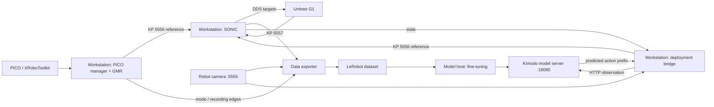

# Architecture and Responsibilities

Teleoperation and deployment share SONIC. PICO/GMR supplies the teleoperation reference; Kimodo supplies the deployment reference. Do not run both reference publishers concurrently. The recorder saves data and does not control the robot.

| Layer | Main implementation | Responsibility |
|---|---|---|
| Teleoperation | `pico_manager_thread_server.py` | Inputs, calibration, modes, GMR, hand mapping |
| Recording | `run_data_exporter.py`, `features_sonic_vla.py`, `exporter.py` | Synchronization, fields, LeRobot video/Parquet export |
| Low-level control | `g1_deploy_onnx_ref.cpp` and headers | Reference tracking, state output, motor targets |
| Training adapter | Parent repository `data/realworld_loader.py` | Fields, coordinates, and hand representations |
| Policy server | `real_world_server.py`, parent `model/kimodo_policy.py` | Checkpoint, text conditioning, diffusion, RTC |
| Bridge | `run_kimodo_sonic.py`, `kimodo_sonic_bridge.py` | Asynchronous requests, queue, action validation, publishing |
| Lifecycle | `deployment_lifecycle.py` | Initial pose, settling/history readiness, HOLD |
| Hands | `hand_stability.py` | Thresholds, confirmation intervals, state across accepted chunks |

GMR and SONIC are required; Isaac Sim/Lab are not. The remote GPU handles the policy, while SONIC native inference still runs on the workstation GPU.

Common example: predict 50 model frames, execute 15, model rate 30 Hz, stream rate 50 Hz, 10 denoising steps, RTC overlap 8 / frozen 2 / ramp 1.0. Fifteen model frames span 0.5 seconds and become 25 control references. RTC overlap, SONIC lookahead, and reference-stream overlap belong to different stages and are not interchangeable.

The bridge permits one inference request in flight and requests early based on remaining queue duration and recent latency. Queue thresholds do not establish a fixed observation period. An empty queue holds the reference; it does not indicate task completion.

Task-specific initialization prepares posture and history before model execution. Ctrl+C HOLD continues publishing the last reference with zero reference velocity and requires live SONIC and communication.
